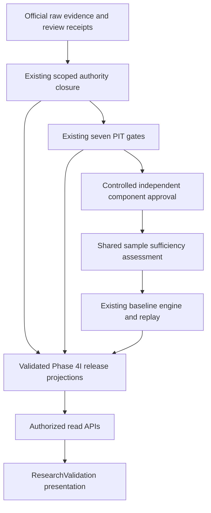

# Worklog 3.1.3 Phase 4I — implementation audit

Baseline: main `cd0254aeb85298218d2d03efa443d36b4fbc2ff2`; v3.1.2 release points to the same SHA. Main CI 42108240511: all 15 jobs passed. All 548 tracked files match local sources (BOM/newline representation permitted). Root AGENTS.md applies. Read implementation, engineering, AuthorityClosureReport, PITEligibilityReport, DatasetReadiness, ModelValidationStatus, APIContractChange and api-v1 from 3.1.2 before implementation.

## Count reconciliation

Frozen request `phase311-request`: 20 Price facts + 1 Institutional fact = 21 total facts. All 21 checksums are unique; 20 price instrument/date keys; one requested instrument/date observation (2330, 2026-09-30); zero eligible observations and zero approved research samples. The Institutional row shares a trading date with a Price row but is a different dataset type, not a duplicate. Expected historical-universe denominator remains unknown/null. Previous prose/engineering/smoke used 20 as total raw; 3.1.2 JSON correctly used 21. Preserve historical receipts and introduce explicit counting fields instead of rewriting evidence.

## Gap Matrix

| Capability | Existing | Phase 4I gap/action |
|---|---|---|
| Acquisition/review | immutable EvidenceAcquisitionStore, ledger, 20 scoped claims | inspect official historical publication/revision sources; retain raw/review receipts, unknown remains unknown |
| Closure | six-domain AuthorityClosureStore; scoped approvals | requirement/applicability/decision/unresolved projections reuse validated claims |
| PIT | seven gates, nullable availability, replay, revocation | expose count reconciliation and gate aggregation without duplicate PIT engine |
| Dataset | independent ComponentDatasetStore | separate approved dataset from adequate sample; no Trend-to-other-components promotion |
| Baseline | RealBaselineStore/ResearchEngine, existing partial diagnostics | shared sample assessment must expose INSUFFICIENT_SAMPLE/null metrics; completed output only after verified baseline replay |
| API | eligibility-summary, coverage, claim detail, provenance | five complementary read routes, share Application projection, no approval writes |
| UI | basic ResearchValidation table | claim queue, PIT details, readiness, Trend progress and replay state through API |
| Formula | 19 features, fixed six weights and golden digest | unchanged; no embedding of new orchestration into FormulaDigest |

## API Reuse Matrix

| Resource | Reuse | Additive route |
|---|---|---|
| Claims | `/authority/claims` and claim identity | `/authority/closure-queue`, `/authority/claims/{id}/evidence` for priority and reviewer/source applicability |
| PIT | `/pit/observations/{id}/eligibility`, dataset `/coverage` | none |
| Dataset | `/research/eligibility-summary`, `/datasets/{id}/coverage` | `/research/datasets/{id}/readiness` for counts/approval/sample separation |
| Research | run/provenance/metrics and component validations | `/research/runs/{id}/validation-summary`, `/research/runs/{id}/replay-status` |

All new resources use ApiAuthorityRead or ApiResearchRead, existing pagination/date semantics where applicable, trace/ProblemDetails. DTOs contain no archive paths. New work stays in Application and API; existing Api-to-Web hosting/EF transition remains.

## Dependency Graph

## PR-1 through PR-5 delivery stages

1. PR-1 audit/count reconciliation/API reuse plan (this file, before code changes).
2. PR-2 authority requirements, applicability, reviewer decisions and source inspection.
3. PR-3 PIT/readiness/sample gating and controlled research replay.
4. PR-4 API Phase C and API-backed website.
5. PR-5 regression, reports, same-SHA integrated release validation.

Stages will be recorded as reviewable commits in an integration PR; user explicitly authorizes Git and deployment. No authority approval, paid resource, database schema, production trading or promotion is authorized by that release instruction.
