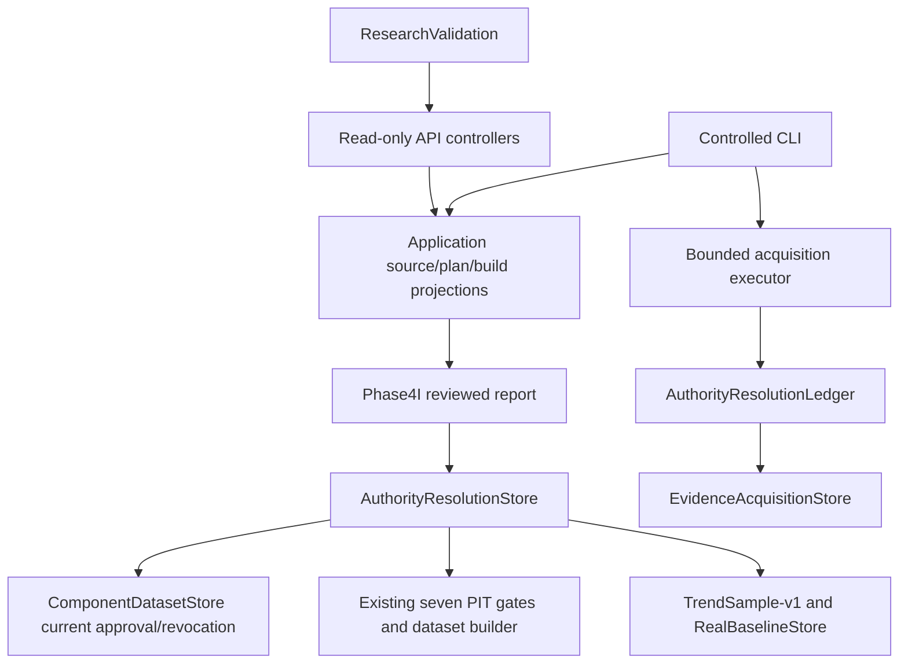

# Phase 4J audit — 3.1.4

Base main/release 3.1.3: `dc0f7634c176c97b6efc7268e3161112b9655eba`. Same-SHA main CI 42170692093 succeeded; 572 tracked source files verified against Git blob hashes (encoding/newline representations normalized). Audit performed before implementation, 2026-11-07.

Read AGENTS.md, desktop Phase 4J specification, implementation/engineering/APIContractChange 3.1.3 and the AuthorityClosureReport, PITEligibilityReport, DatasetReadiness and ModelValidationStatus artifacts. User explicitly authorizes Git publishing and deployment for this task; this overrides the document's default no-publish instruction. No purchase, provider contact, schema change, promotion or trading enablement.

## Capability matrix

| Capability | Reuse | Necessary addition |
|---|---|---|
| Raw acquisition and replay | EvidenceAcquisitionStore (16 MiB, hash/review receipts) | Fixed registry URL selection, bounded timeout/retries/provider budget and concurrency |
| Authority task history | AuthorityResolutionLedger | Deterministic source/version-specific plan, sanitized attempts |
| Authority and revocation | AuthorityResolutionStore, ComponentDatasetStore.Current | Source/version change impact and reevaluation status; never alternate approval |
| Historical applicability | Existing reviewer receipts, Phase4IProjection.Queue | Explicit source capability and per-claim next action |
| PIT/data construction | Seven existing gates, HistoricalDatasetBuilder | Shared component build report, independent component approvals |
| Research | Phase4IWorkflow, TrendSample-v1, RealBaselineStore | Readiness projection only; retain controlled execution |
| API/UI | Existing read policies, Phase4IReadAdapter, ResearchValidation | Sources, plan/attempts/actions and build-readiness DTOs |

## Source gap matrix

| Scope | Existing evidence | Gap |
|---|---|---|
| Historical publication / revision | Current official pages and captured query responses | Original publication time, retained historical versions, correction timing unproven |
| Identity / universe | Current official service descriptions | Historical listing, symbol, transfer, delisting, suspension and denominator |
| Calendar | Scoped reviewed references | Historical sessions and emergency closures |
| Price / corporate actions | 20 price facts, 1 institutional fact | Approved price basis / corporate actions and historical availability |

Twenty claims remain unresolved for requested historical scope. Captured source versions are raw content identities, not market revision identities. No source is granted VERIFIED historical capability from URL existence or capture time. Paid/login/contact steps remain manual. Dataset: 21 facts, 1 requested observation, 0 eligible observations, 0 approved samples; Trend NOT_RUN, threshold UNRESOLVED, Phase5 LOCKED.

## API reuse matrix

| Existing API | Decision |
|---|---|
| authority/closure-queue and claims/{id}/evidence | Retain; add source-aware next actions to plan representation |
| research/datasets/{id}/readiness | Compatible extension with component build reports |
| research/runs/{id}/validation-summary and replay-status | Retain Trend policy and replay semantics |
| authority sources / acquisition-plan / acquisition-attempts/{id} | New read resources; no HTTP acquisition/approval |
| research/components/{component}/readiness | New independent component projection |

## Dependency graph

Source catalog is derived metadata over existing archived evidence, never a second Authority registry. UI contains no scoring or eligibility formula. Public reports describe a verified export snapshot, not continuous revalidation of offline stores; execution must recheck current authority and approval.
