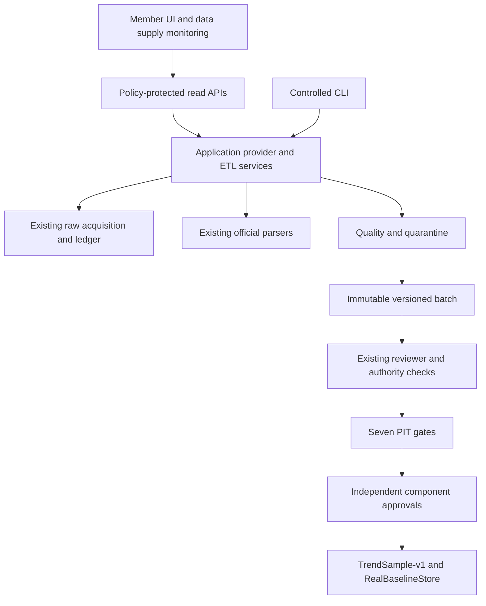

# 3.2.1 audit — Phase 4K + member access control

Base main `ba18eabd8cd754a5e28f984ea817c7b48448b627`, release v3.1.4. Previous same-SHA PR CI 42351321081/main CI 42351632332: 15 jobs successful. All 597 tracked files verified against published Git blob identities before changes. Read AGENTS.md and both desktop specifications. User explicitly authorizes local implementation, Git publishing and deployment as **3.2.1**, superseding the documents' default review-only release restriction. No production migration, purchase, contact, trading or promotion authorized.

## ETL gap matrix

| Stage | Existing reuse | Addition |
|---|---|---|
| Extract | EvidenceAcquisitionStore, Phase4JAcquisition, registry/ledger | Typed provider adapter and request capability validation |
| Transform | ComponentEvidence.ParsePrice, OfficialHistoricalSource, OfficialParser | Versioned normalization orchestration and code SHA binding |
| Quality | Existing historical schema/PIT validators | Separate quality report and quarantine; no automatic PIT approval |
| Load | Immutable raw archive, HistoricalDatasetStore | Idempotent versioned normalized batch/job state and lineage |
| Research | AuthorityResolutionStore, ComponentDatasetStore, Phase4IWorkflow, RealBaselineStore | Reuse current gates and source revocation propagation |
| Delivery | Existing read policies/OpenAPI and ResearchValidation | Provider/ETL monitoring APIs and UI |

## Provider capability matrix (audit)

| Provider | Existing capability | Boundary |
|---|---|---|
| TWSE | Official raw archive, monthly price/institutional parser, scoped source registry | Historical availability/revision remain unproven |
| TPEx | MarketData official parser and approved-host transport | Adapter only for explicitly supported schema/source; never infer historical authority |
| FinMind | Existing configured market-data client | No ETL access unless settings, authorization and dataset contract are explicit; no secret export |

## API reuse matrix

Retain authority sources/acquisition-plan/attempts, claims, PIT, dataset-readiness and validation-summary. Add only distinct provider and ETL job/quality/lineage/health read resources. Do not add public execute/approve/promote APIs. Read controllers call Application services, never DbContext. Existing anonymous basic quotes/industries remain public; scan/analysis endpoints require the swing feature policy. This security tightening must be explicitly documented and tested rather than hidden as a schema-only compatible change.

## Dependency graph

## Access findings before implementation

Swing page already requires login, but SwingSearch/SwingData/SwingBacktest and research/radar JSON actions currently do not. Strategy pages and radar job routes need explicit feature protection. Paper actions already require login and PaperTradingService scopes accounts by ICurrentUser, but feature policies and consistent JSON challenge/cache behavior are absent. Strategy signals are shared system scan records (not member-owned); they require member feature access plus valid object/symbol binding. Recommendations may be shared system records or personally owned; retain existing AccessibleAsync rules. Do not invent ownership columns or a second membership system.

Api→Web hosting/EF is transitional. Move the current-user contract to Application while preserving its namespace; keep the HTTP implementation and EF adapters at the hosting boundary. No broad EF migration or database schema change is planned.

Pkcs advisories verified against Microsoft dotnet/runtime security advisories GHSA-846f-f764-76mx and GHSA-2fmv-rv2c-59x7. Patched supported versions include 9.0.21 and 10.0.13. Trace the actual transitive dependency and select an appropriate patched package, then verify resolved dependencies, auth compatibility and regression tests.
