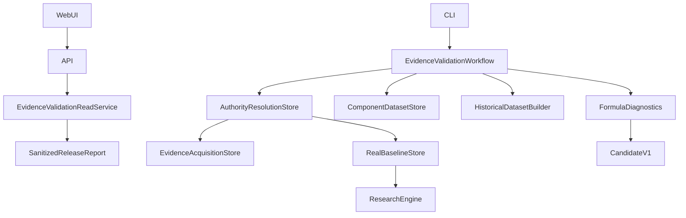

# 3.1.2 Audit First

Base main / v3.1.1: `efde456dbb8b25c1596a61d869ed5ad78d387226`.
Source: desktop `# Worklog v3.1.2 — Evidence-Driven.txt`.

## Existing Capability Matrix

| 能力 | 已查核類別／方法 | 本版處理 |
|---|---|---|
| 20 Claims 與精確 scope | AuthorityResolution.Evaluate、AuthorityClosureStore.RequiredClaims/Subject | 重用，不以新清單取代核准 |
| Raw 封存與 review | EvidenceAcquisitionStore.ReadArtifact/ReadReview、AuthorityResolutionLedger.Acquire/Attempts | 按 priority 查核所有 claims，保留原始證據 |
| 逐筆 PIT | AuthorityResolution.Availability/Revision/Evaluate、HistoricalDatasetBuilder.Build | 重用全部 gates，加公開安全的 report projection |
| Component approval / revocation | ComponentDatasetStore.Approve/Replay/Current、AuthorityResolutionStore.Approve/Replay | 保留受控 CLI，新增協調不繞過 gate |
| Baseline / replay | AuthorityResolutionStore.Baseline/BaselineReplay、RealBaselineStore | 共用既有執行器，不重建研究引擎 |
| 固定模型 | V3CandidateCalculator、FormulaCatalog、FullEvidenceModel | 公式、19 features、digest、null 與 golden 不變 |
| 診斷 / 治理 | FormulaDiagnostics.Validate/Build、CandidateGovernance | 核准後才診斷；future labels 與 OOS 不流入 development |
| API | ResearchReadService、FormulaResearchService、ReadControllers | 原契約保留，補 eligibility / provenance / observation / coverage |
| 回歸 CI | ci.yml、ApiContractChecks、V3*Checks、PaperTradingChecks | 同 SHA 驗證，不以工程 PASS 宣稱研究 PASS |

## Missing Capability / Gap Matrix

| 缺口 | 實作決策 |
|---|---|
| Authority/PIT/store 仍在 Web | 六份 HistoricalResearch contracts 移至 Domain；HistoricalResearch 與 ResearchStore 移至 Application，namespace 保留 |
| 缺單一 research eligibility 協調及來源鏈 | Application EvidenceValidationWorkflow，呼叫既有 resolution / approval replay；封存安全 release report |
| API 看不到每筆 Gate/資料身分 | 新增四個唯讀端點，Auth、分頁、日期、digest、trace 與 fail-closed |
| 新報告須防竄改及版本錯置 | typed report digest、來源 request/evaluation digest、formula/parameter/version-set 綁定；公開端不讀 raw archive |
| 真實 availableAt / revision 證據不足 | 全 20 claims 列出 scope、review、raw identity 與 blocking；未證明保持 UNKNOWN/UNPROVEN |
| 非 Trend 構面尚無自己的核准資料 | 六構面分列資格；不由 Trend 推導其餘構面或 full model 核准 |

## Duplicate Implementation Risk

不得再寫 availability、revision、universe 或評分判定。新協調層只組合既有 gate 結果、核准 replay 與 FormulaDiagnostics。HTTP 不核准、不公開 archive 路徑、不接受任意 raw reports。保留 ResearchStore 的 development/OOS 邊界。Blocked 報告不是核准 receipt。

## Dependency Graph

新協調與既有 stores 位於 Application，模型契約及純公式位於 Domain。Web 的 EF、行情 adapter、登入 hosting 仍留存；Api → Web hosting 是既有過渡相依，不宣稱完全拆成獨立部署。
